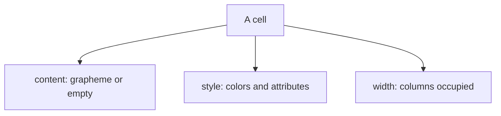

A terminal displays a grid of cells. Each cell has text, a style, and a width
in terminal columns. The text usually represents one visible character, called
a *grapheme*. A grapheme can contain several Unicode code points.



## Wide characters

Some graphemes occupy several columns. The first column holds the text.
Each additional column holds a *continuation*. The grid creates these
continuations when you write a wide character.

A blank cell represents a space. A new [buffer]()
starts with blank cells.

## Borrow a cell or keep a snapshot

A grid read returns a `CellRef`. This borrowed value lets you inspect the text,
width, colors, attributes, and hyperlink. It stays valid while its source
remains borrowed.

A `Cell` is an owned, portable value. Use it for reusable content or a snapshot
that must outlive the source.

```rust
use uncurses::buffer::{Buffer, Surface};
use uncurses::style::Style;

let mut frame = Buffer::new(4, 1);
let cell = frame.new_cell("世", Style::new()).unwrap();
frame.set_cell((0, 0).into(), cell.as_ref());
let snapshot = frame.cell((0, 0).into()).unwrap().to_owned();
assert_eq!(snapshot.content(), "世");
```

The buffer measures the grapheme with its [width policy]().
Copies preserve that measured width.

See the [offscreen guide]()
for cell factories, snapshots, and copies between grids.
The [cell reference](/api/uncurses/cell/index.html) covers explicit imports and cell accessors.
