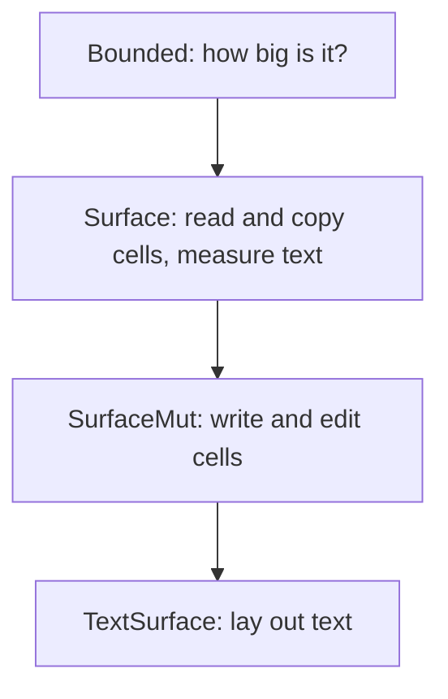

A surface is a rectangular cell grid. The surface traits let one function
work with a buffer, a clipped view, a window, or a screen.
Choose the trait that describes the work your function needs.

## A shared contract

`Bounded` describes the rectangle. `Surface` adds borrowed cell reads and
copies into another surface. It also supplies the text width policy and a
cell factory.



`SurfaceMut` adds cell writes, style changes, and grid operations.
`TextSurface` adds text output and measurement with the surface's width policy.
These traits preserve wide characters and their continuation columns.

```rust
use uncurses::style::Style;
use uncurses::text::TextSurface;

fn label(target: &mut impl TextSurface) {
    target.set_str((0, 0), "Ready", Style::new().bold());
}
```

The same function can write into a `Buffer`, `TextBuffer`, or
[`Screen`]().

## Choose a surface

`Buffer` owns a grid and its width policy. `TextBuffer` wraps a buffer for
offscreen text output. Both can serialize a frame through `Encode`.

`Window` owns a grid with a destination position.
`View` borrows part of another surface and clips access to that rectangle.
A view uses the source coordinates.
`Screen` combines a grid with a renderer and writer.

Text methods draw literal text. Use `Painter` when strings contain style
escapes that you want to interpret.

See the [offscreen guide]()
for copies, cell reads, and snapshots.
See the [styling guide]()
for style changes and `Painter`.
The [surface reference](/api/uncurses/buffer/trait.SurfaceMut.html) defines grid operation behavior.
