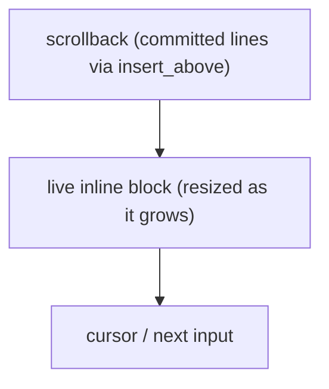

Most fullscreen apps take over the terminal with the alternate screen. Many
tools, prompts, progress bars, pickers, and REPLs want to draw a live region
right where the cursor is and leave the scrollback intact. That is inline mode,
and it is the uncurses default.

## The idea

A `Program` owns the terminal session, input, and terminal modes. Its `Screen`
is the renderer you reach with `program.screen_mut()`. After `init()`, that
screen starts inline with the cursor visible: it owns a block of rows starting at
the cursor and draws there, in the normal buffer. You decide how many rows it
owns with `resize`, and you can grow or shrink that block as your content
changes. Nothing scrolls into history unless you ask for it.

```rust
use uncurses::buffer::Bounded;
use uncurses::program::Program;
use uncurses::style::Style;
use uncurses::text::TextSurface;

fn main() -> std::io::Result<()> {
    let mut program = Program::stdio()?;
    program.init()?; // inline, cursor visible, no alternate screen

    // Claim one content row plus one trailing blank row right here at the cursor.
    let width = program.screen().width();
    let screen = program.screen_mut();
    screen.resize((width, 2));
    screen.set_str((0, 0), "working...", Style::new());
    screen.render()?;

    program.finish()
}
```

Inline mode leaves the alternate screen and the cursor as they are.
`enter_alt_screen` and `hide_cursor` are opt-in, fullscreen-style choices.

## Fullscreen is a render property

Inline versus fullscreen is the screen's `fullscreen` render property.
Inline means relative addressing in a band in the normal buffer. Fullscreen means
absolute addressing over the whole viewport, which is what you want after
switching to the alternate screen buffer.

Use `program.enter_alt_screen()` and `program.exit_alt_screen()` to switch
buffers. They emit DECSET 1049 or DECRST 1049, flush, and set the screen's
`fullscreen` property to match. Calling `program.screen_mut().set_fullscreen(..)`
directly only retargets how frames are addressed. It emits no terminal mode and
switches no buffers, so use it only when you are driving the terminal bytes
yourself.

## Growing the region

Use `resize_height` when your content changes height.
The next render preserves unchanged rows, draws added content, and erases
removed inline rows. Added blank rows also extend the region.
The same height leaves the frame unchanged.

```rust
use uncurses::{screen::Screen, style::Style, text::TextSurface};

fn main() -> std::io::Result<()> {
    let mut screen = Screen::new(Vec::new(), (40, 1));
    screen.set_str((0, 0), "First row", Style::default());
    screen.render()?;
    screen.resize_height(2);
    screen.set_str((0, 1), "Second row", Style::default());
    screen.render()
}
```

Use `resize` after a terminal resize. It re-establishes the region and requests
a full repaint, including when its dimensions stay the same.

Run `cargo run -p examples --example inline_height` to inspect the emitted bytes.

To follow the terminal instead of your own content, use
[`autoresize`](https://docs.rs/uncurses/latest/uncurses/program/struct.Program.html#method.autoresize):
it reads the size the operating system already knows, keeps your inline height,
and skips reports that leave the cell grid unchanged.

The renderer keeps the block anchored in the normal buffer, so growing from two
rows to ten expands the managed area instead of taking over the whole terminal.

## Placing the caret

An inline prompt keeps the cursor visible, and you usually want it sitting on the
character the user is editing, not wherever the last cell write happened to land.
Stage it with `set_cursor_position` and every `render` parks the cursor there at
the end of the frame. Drawing and cursor coordinates are `(x, y)`, zero-based;
terminal row and column reports are one-based.

```rust
let screen = program.screen_mut();
screen.set_str((0, 0), &line, Style::new());
screen.set_cursor_position((caret_col, 0));
screen.render()?;
```

It is sticky, so set it when the caret moves and later frames keep the cursor
there on their own. Call `clear_cursor_position` to stop steering it. Visibility
stays separate: `program.show_cursor()` and `program.hide_cursor()` decide
whether the caret is drawn, while `set_cursor_position` only decides where it
rests.

Use `screen.move_cursor_to((caret_col, 0))?` for an immediate move and flush.
This leaves the staged resting position unchanged. Past a cluster whose width
is uncertain, the move follows the last rendered cells, not pending edits.
The terminal places the cursor, so `tracked_cursor()` then returns `None`.
After a resize or screen switch, render the content before you place the caret
relative to that content.

## Releasing completed rows

Use `screen.commit_rows(count)?` when the top rows of your inline region are complete.
It renders pending edits and releases those rows as permanent output.
The retained rows stay on the terminal and start at row zero in the smaller region.
Releasing every row starts an empty region on the next line.

For streamed text, keep the unfinished line in the region.
Use `resize_height` to add new lines, then commit the completed lines.
Run `cargo run -p examples --example streaming -- --dump` to inspect this process.

The method clamps the count to the height.
Fullscreen screens and zero counts preserve pending edits and output.
If the initial render fails, the screen retains its rows.
If the final flush fails, the rows stay released.
Retry with `std::io::Write::flush(screen)` to send pending bytes without releasing more rows.
The screen retains unsent bytes after a write error and removes bytes that the writer accepts.
If the writer's flush fails, the next retry flushes the writer without repeating accepted bytes.

## Inserting separate output

Sometimes you want a line to leave the live region and become permanent history,
the way a shell prints a command's output above the next prompt. That is
`insert_above` on `Screen`: it writes content into the scrollback *above* your
inline block, then keeps drawing the block below it.

```rust
program.screen_mut().insert_above("compiled in 1.2s")?;
```

Use styled text: text, newlines, tabs, complete SGR style sequences, and
OSC 8 hyperlinks. The caller must ensure that the content satisfies this
input requirement.

**Warning:** Keep other controls and escapes out of the input.
Cursor movement, erasure, scrolling, and mode changes can overwrite the live
block or preceding output. This includes NEL, IND, and RI controls and their
equivalent escape sequences.

With styled text, it flushes immediately and leaves your live block untouched.
The committed line lands in scrollback, and the block stays below it.

Wrapped lines follow the screen's width policy, including wide characters.
ANSI style sequences contribute no columns.
Tabs keep their bytes and follow stops every eight columns, with a clamp at
the right edge. `Program` establishes these stops during session setup.
If you drive `Screen` directly, establish the same terminal stops first.

`insert_above` converts supported UTF-8 C1 style and hyperlink sequences to
7-bit forms before it measures and writes the content.
Hyperlink payloads retain their original UTF-8 bytes.
Run `cargo run -p examples --example ansi_text` to see both input encodings
produce the same inserted bytes.

Use `screen.set_ambiguous_wide(true)` when the terminal displays ambiguous
characters as two columns. Rewrite existing text after changing that policy.

A multiline prompt that commits its buffer on `Ctrl-D` does exactly this: render
the editable block inline, and on commit push the finished text up with
`insert_above` and clear the block for the next entry.



## Teardown

Finishing an inline session resets the modes the `Program` emitted, leaves the
last frame in place, and returns the cursor to the shell.


Reserve a trailing blank row in your block (size it one taller than your content)
so the prompt comes back on a clean line.


See the `inline_input` example for a complete multiline inline prompt with
editing, paste, and `insert_above` commits.
