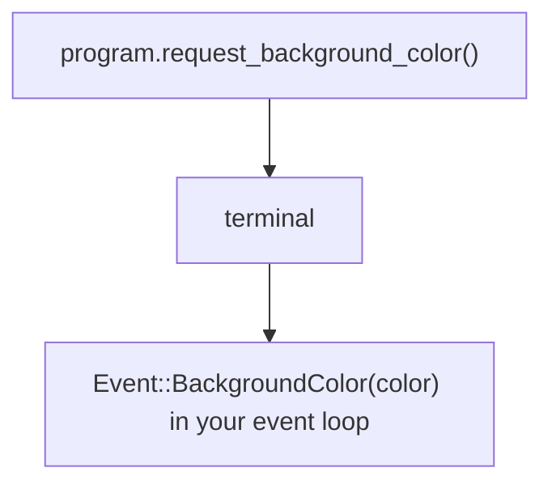

Terminals can answer questions about themselves: the background color, the pixel
size of a cell, the current cursor position, and what features they support.
uncurses models this as a request you send and a reply that comes back as an
ordinary event.

## The request and reply model

You write a request, the terminal writes an answer, and that answer arrives in
the same event stream as keystrokes. There is no separate "query" channel.




`Program::init()` and `Program::init_with()` set the session up and ask nothing
about what the terminal can do. They do write: raw mode, tab stops, and the
options you turned on. The capability queries below are always a call you make.


## Capability probing

Set `ProgramOptions::query_program_status` to `true` to include OSC 7501
support detection in `query_capabilities`. The option defaults to `false`.
See the
[program status guide]() for reports,
feature detection, and record lifetime.

Pass `ansi::drag_drop::REQUEST_DRAG_DROP` as extra bytes to query Kitty drag
and drop support. Read the result through `capabilities().drag_drop()`.
See [Drag and drop]() for the protocol workflow.

Call `program.query_capabilities(&extra_bytes)?` when you want uncurses to ask
for its standard capability set. It writes the default queries, then your extra
bytes, then Primary Device Attributes last, and flushes. The Primary DA reply is
the sentinel: because its request was sent last, seeing
`Event::PrimaryDeviceAttributes` means every earlier reply in that batch has
already been delivered.

`query_capabilities` only writes. Consuming the replies is your job, so bound the
wait with `poll_event(Some(timeout))`. A silent terminal never answers, including
the sentinel.

Reading those replies is not purely passive. A few are adopted as they pass
through, each gated by a `ProgramOptions` field that defaults to `true`:
`prefer_synchronized_output`, `prefer_grapheme_clusters` and
`prefer_in_band_resize`. Set any of them to `false` to record the capability
without acting on it.

What adoption does differs by capability. Grapheme-cluster mode and in-band
resize are terminal modes, so adopting one emits the mode, records it in the
program's emitted-mode set, and `finish()` undoes it. Synchronized output is a
render property: adoption only tells the screen to start wrapping frames in the
2026 markers, so nothing is written at adoption time and there is nothing for
`finish()` to undo.

```rust
use std::time::{Duration, Instant};

use uncurses::event::Event;
use uncurses::program::Program;

fn main() -> std::io::Result<()> {
    let mut program = Program::stdio()?;
    program.init()?;
    program.query_capabilities(&[])?;

    let deadline = Instant::now() + Duration::from_millis(300);
    while let Some(timeout) = deadline.checked_duration_since(Instant::now()) {
        if !program.poll_event(Some(timeout))? {
            break;
        }
        if matches!(program.try_read_event()?, Some(Event::PrimaryDeviceAttributes(_))) {
            break;
        }
    }

    let _caps = program.capabilities();
    program.finish()
}
```

Reads on `Program` auto-observe, so the loop above updates `capabilities()` as it
reads replies. An ordinary event loop gets the same benefit for free: if it keeps
calling `read_event`, `try_read_event`, or `poll_event` plus a read, capability
replies are applied as they arrive.

That covers every reply describing the terminal, not only the ones
`query_capabilities` asks for. A `request_background_color` answered mid-session
is recorded just the same, so you can read it back from `capabilities()` later
instead of matching the event and storing it yourself. Sizes are the exception:
window and cell geometry lives on `Program` as `window_cells()`,
`window_pixels()`, and `cell_pixels()`, since it changes with every resize.

## Asking one question

`Program` also has `request_*` methods for common queries. Each one sends the
request and flushes; the reply shows up later as an `Event` you match on in your
loop.

```rust
use std::time::{Duration, Instant};

use uncurses::event::Event;
use uncurses::program::Program;

fn main() -> std::io::Result<()> {
    let mut program = Program::stdio()?;
    program.init()?;
    program.request_background_color()?;

    let deadline = Instant::now() + Duration::from_millis(300);
    'wait: while let Some(timeout) = deadline.checked_duration_since(Instant::now()) {
        if !program.poll_event(Some(timeout))? {
            break;
        }
        while let Some(ev) = program.try_read_event()? {
            if let Event::BackgroundColor(color) = ev {
                let _ = color;
                break 'wait;
            }
        }
    }

    program.finish()
}
```

These cover the everyday questions: the foreground, background, cursor, and
palette colors; the cell and window pixel size; the cursor position; the color
scheme (dark or light); terminal visibility; mode state; clipboard contents; and
feature probes like kitty keyboard and modify-other-keys. For the complete set,
scan the `request_*` methods on
[`Program`](/api/uncurses/program/struct.Program.html) in the API
reference; each one documents the exact `Event` variant used for its reply.

For cursor reports distinct from modified F3, use
`program.request_extended_cursor_position()?` on terminals that support DECXCPR.
The reply arrives as `Event::CursorPosition { position, page }`.
`position` holds zero-based cell coordinates.
`page` holds the reported one-based page number, or zero when absent.
`request_cursor_position()` requests standard CPR.
Run `cargo run --example query -- --extended` to try the extended request.

## Read a clipboard reply

Call `program.request_system_clipboard()?` or
`program.request_primary_clipboard()?`.
The terminal decides whether its access policy permits a reply.
Use a caller deadline if your application must stop the wait.

The reply arrives through `ClipboardStart`, zero or more `ClipboardChunk`
events, and `ClipboardEnd`.
Keep the selection from the start event when your application needs it.
Process each chunk as it arrives to keep memory use independent of the total
payload size.
Chunks contain raw wire bytes, normally base64.
Chunk boundaries can split a base64 group, so retain partial groups if you
decode the payload incrementally.

This current-source fragment counts bytes without retaining clipboard contents:

```rust
use uncurses::event::Event;

fn observe_clipboard(event: Event, bytes: &mut usize) {
    match event {
        Event::ClipboardStart { .. } => *bytes = 0,
        Event::ClipboardChunk(chunk) => *bytes += chunk.len(),
        Event::ClipboardEnd { complete } => {
            println!("Clipboard: {bytes} wire bytes; complete: {complete}");
        }
        _ => {}
    }
}
```

Treat `complete: false` as an interrupted transfer.
The source ends an active reply after two seconds without new input.
It delivers retained bytes before the incomplete end event.
Use `EventSource::with_clipboard_idle_timeout` to choose another idle timeout.
Use `set_clipboard_idle_timeout` on an existing source.
Pass `None` to preserve framing through long pauses.
The setter restarts the idle wait during a reply and refreshes active async waits.

Call `EventSource::end_clipboard()` for explicit recovery.
It delivers retained bytes before an incomplete end and wakes active async readers.
Later bytes count as ordinary input.
Idle recovery is a heuristic: keys before expiry can become payload, and delayed
payload after expiry can become keys.

Caller timeouts and wakes preserve a reply, subject to its independent idle timeout.
A fatal input or readiness error can end your read loop.
Discard any unfinished transfer when your application stops that loop.
See the [`ClipboardEnd` contract](/api/uncurses/event/enum.Event.html#variant.ClipboardEnd)
for framing and input-error details.

Run `cargo run --example clipboard` for a complete example with a caller
deadline and terminal cleanup.
It reports the byte and chunk counts, rather than clipboard contents.
Add `-- --no-idle-timeout` to disable idle recovery in that example.

## Extra queries in the capability batch

If you want your own query to share the Primary DA sentinel, pass its bytes as
`extra`. uncurses writes them after the default capability queries and before the
sentinel, so the same drain loop covers both the built-in replies and yours.

```rust
use std::time::{Duration, Instant};

use uncurses::ansi::color::REQUEST_BACKGROUND_COLOR;
use uncurses::event::Event;
use uncurses::program::Program;

fn main() -> std::io::Result<()> {
    let mut program = Program::stdio()?;
    program.init()?;
    program.query_capabilities(REQUEST_BACKGROUND_COLOR)?;

    let deadline = Instant::now() + Duration::from_millis(300);
    'wait: while let Some(timeout) = deadline.checked_duration_since(Instant::now()) {
        if !program.poll_event(Some(timeout))? {
            break;
        }
        while let Some(ev) = program.try_read_event()? {
            match ev {
                Event::PrimaryDeviceAttributes(_) => break 'wait,
                _ => {}
            }
        }
    }

    // Recorded on the way through, so there is nothing to match on.
    let _bg = program.capabilities().background_color();
    program.finish()
}
```

## Asking for a current setting

The queries above ask what a terminal can do. DECRQSS asks what it is doing
right now: the active text attributes, the current cursor style. That makes it a
different kind of question, so it sits outside the default capability set and you
send it as an extra query.

```rust
use uncurses::ansi::status::write_decrqss;
use uncurses::event::{Event, SettingReport};
use uncurses::program::Program;

fn main() -> std::io::Result<()> {
    let mut program = Program::stdio()?;
    program.init()?;

    let mut query = Vec::new();
    write_decrqss(&mut query, "m")?; // "m" is SGR, the active text attributes
    program.query_capabilities(&query)?;

    let mut sgr = None;
    loop {
        match program.read_event()? {
            // The reply to the only DECRQSS we sent, so it answers "m".
            Event::SettingReport(SettingReport::Raw(body)) => sgr = Some(body),
            Event::SettingReport(SettingReport::Refused) => break,
            Event::PrimaryDeviceAttributes(_) => break,
            _ => {}
        }
    }

    let _ = sgr;
    program.finish()
}
```

This is the one reply the program does not record for you. Every other answer
says what it is about, so it can be filed on its own: a mode report carries its
mode, an XTGETTCAP reply its capability names. A DECRPSS reply carries neither.
A refusal is a bare `Refused` that names nothing at all, and a success is a
`Raw` holding the whole CSI sequence with the control function and its
parameters run together, so `">4;2m"` cannot be told apart from an SGR reply by
inspection alone.

What the reply is about lives in the request, and the request is yours. Send one
DECRQSS at a time, or track the order you sent them in, and match the replies
up as they arrive.

## Asking without a Program

Without `Program`, a request is just bytes you write to the terminal, and the
reply comes back through an `EventSource`. The
[`ansi`](/api/uncurses/ansi/index.html) module has named constants for common
requests, but any escape you write works the same way. Send Primary DA last if
you want a terminator, and use a deadline for terminals that do not answer.

The `query` example (`cargo run --example query`) shows this raw-byte pattern.
The `gradient` example shows the usual app pattern: call
`program.query_capabilities(&[])?`, keep reading events in the normal loop, and
let Program's auto-observation update capabilities as replies arrive.
